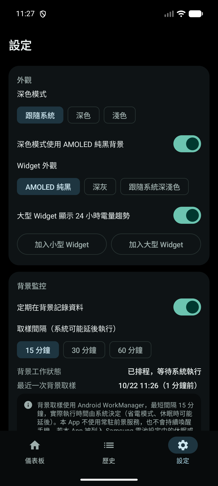

# Galaxy System Monitor

[繁體中文](README.md) | **English**

A native Android phone-health monitor written in Kotlin, with home-screen widgets. It reads real battery, memory, storage and network information through public Android APIs only, and keeps its history on the device. No root, no account and no internet permission required.

> The app was designed with the Samsung Galaxy S25 Ultra (Android 16) as its primary target, but it has **not yet been tested on that physical device**; see [Limitations](#limitations-and-not-yet-implemented). This project is not affiliated with Samsung.

## Table of Contents

- [Features](#features)
- [Screenshots](#screenshots)
- [Technology and Dependencies](#technology-and-dependencies)
- [Requirements](#requirements)
- [Installation](#installation)
- [Building from Source](#building-from-source)
- [Usage](#usage)
- [Privacy and Permissions](#privacy-and-permissions)
- [Project Structure](#project-structure)
- [Testing](#testing)
- [Limitations and Not Yet Implemented](#limitations-and-not-yet-implemented)
- [Developer and License](#developer-and-license)
- [Reporting Issues](#reporting-issues)

## Features

### What is monitored

| Area | Details |
|---|---|
| Battery | Level, charging status, power source, battery temperature, voltage, Android health status, battery technology, charge cycle count (Android 14+ when the device reports it) |
| Drain / charge rate | Average discharge rate over the last 1, 6 and 24 hours, and average charge rate over the last 1 and 6 hours (percentage points per hour) |
| Battery temperature | Current value, change over the last 1 / 6 / 24 hours (min, max, average), and the highest / lowest reading within the retention period |
| System memory | Device total, available, estimated in-use, usage ratio, the system low-memory threshold and state |
| Storage | Internal storage total, used (including the system), free, usage ratio |
| Network | Connected or not, transport (Wi-Fi, cellular, Ethernet, Bluetooth, VPN), whether routed via VPN, internet capability, system validation result, metered or not, cellular generation (optional), time of the last state change and a recent change log |

### Data accuracy principles

- Values that cannot be read are shown as "unavailable", "insufficient data" or "permission required". They are **never replaced with 0 or an estimate**.
- Abnormal values reported by the system are rejected with an explanation, for example a temperature of exactly 0, a temperature outside −30 to 90 °C, or an implausible voltage.
- Drain rates only use pairs of adjacent recorded samples that are both discharging (or both charging). Gaps longer than 3 hours, level increases while unplugged, and sudden jumps are excluded, and the actual time range of the data used is displayed.
- Charts break the line at gaps in the data. Nothing is interpolated.

### History and charts

- Stored locally with Room, kept for 30 days by default (7, 14, 30, 60 or 90 days selectable); expired rows are deleted automatically.
- Charts can show 1 hour, 6 hours, 24 hours or 7 days. Tap a chart to inspect a single sample; the actual available data range is labelled.
- The History screen shows level, temperature and memory charts plus the 100 most recent samples.
- All of the app's history can be cleared from Settings (only this app's database is affected).

### Home-screen widgets

| Widget | Target size | Contents |
|---|---|---|
| System Monitor (small) | 4 × 2 | Battery level, battery temperature, drain (or charge) rate, network, free storage (when tall enough), update time |
| System Monitor (large) | 4 × 4 | Level with progress bar, charging status, temperature and its hint, drain rate, memory, free storage, network, 24-hour battery-level trend, an "Open details" button |

- The refresh button in the top-right corner updates the widget manually.
- Tapping a section opens the matching detail screen in the app.
- Appearance options: "AMOLED black", "Graphite" or "Follow system light/dark".
- The actual number of cells depends on the launcher and screen.

### Background updates

- Periodic sampling through WorkManager every 15, 30 or 60 minutes, or turned off. Android decides the actual run time.
- Live battery broadcasts are only observed while the app is on screen, which also refreshes the screen every 30 seconds; both stop when you leave the app.
- No foreground service; the device is not kept awake.

### Settings

Dark mode (system / dark / light), AMOLED black background, widget appearance and trend chart, adding a widget directly from the app (when the launcher supports it), background monitoring on/off and interval, background job status, temperature hint thresholds (default: elevated 40 °C, high 45 °C), low-storage threshold (default 10%), history retention, manual refresh, clear history, permission status, and About.

## Screenshots

> These screenshots were taken on an Android emulator (Pixel 7, Android 17 preview image), **not on a Galaxy S25 Ultra**. Some battery values (level, temperature) were simulated during testing with `adb shell dumpsys battery`. The UI language is Traditional Chinese.

| Dashboard | Battery | Battery temperature |
|---|---|---|
|  |  |  |

| History | Settings | Home-screen widgets |
|---|---|---|
|  |  |  |

The battery-temperature screenshot shows how the app displays an unavailable temperature reading (triggered by simulation).

## Technology and Dependencies

| Category | Details |
|---|---|
| Language | Kotlin 2.2.21 |
| UI | Jetpack Compose (BOM 2025.10.01), Material 3 |
| Widgets | Jetpack Glance 1.1.1 |
| Database | Room 2.8.3 (KSP 2.2.21-2.0.4) |
| Background work | WorkManager 2.10.5 |
| Settings storage | DataStore Preferences 1.1.7 |
| Navigation | Navigation Compose 2.9.5 |
| Concurrency | Kotlin Coroutines 1.10.2, Flow |
| Build | Android Gradle Plugin 8.13.0, Gradle 8.14.3 (wrapper) |
| Architecture | MVVM + Repository, manual dependency injection (no DI framework) |
| Charts | Custom Compose Canvas charts (no third-party chart library) |

All dependencies come from AndroidX and official Kotlin libraries. No advertising, analytics or tracking SDKs are used.

## Requirements

| Item | Requirement |
|---|---|
| Android version | Android 12 (API 31) or later; targetSdk is 36 (Android 16) |
| Root | Not required |
| Account / network | Not required |
| Build environment | JDK 17 or later, Android SDK Platform 36 |

minSdk is 31 because the widget target-cell attributes (`targetCellWidth` / `targetCellHeight`) and `TelephonyCallback` require Android 12 or later.

## Installation

### Getting the APK

There is **no pre-built APK and no GitHub Release yet**. Build a debug APK yourself as described in [Building from Source](#building-from-source).

### Option 1: Install directly on the phone

1. Copy `app-debug.apk` to the phone.
2. Open the file on the phone. If prompted, allow "Install unknown apps" for that source.
3. Follow the on-screen instructions.

### Option 2: Install with ADB (optional)

ADB is not required to use the app; it is just a convenient way to install from a computer.

1. On the phone, enable Developer options and USB debugging.
2. Connect the phone over USB and accept the debugging authorization prompt.
3. Run:

```bash
adb devices                                          # confirm the device is connected
adb install -r app/build/outputs/apk/debug/app-debug.apk
```

## Building from Source

```bash
git clone https://github.com/q828626868-cell/GalaxySystemMonitor.git
cd GalaxySystemMonitor
```

Open the folder in Android Studio and let it sync, or build from the command line after pointing Gradle at your Android SDK:

```bash
# Create local.properties (this file is not under version control)
echo "sdk.dir=/path/to/Android/Sdk" > local.properties

./gradlew :app:assembleDebug        # use gradlew.bat on Windows
```

The APK is written to `app/build/outputs/apk/debug/app-debug.apk`.

No signing key is configured for release builds yet.

## Usage

1. **Open the app.** The dashboard reads the current values immediately and starts recording.
2. **Add a widget.** Long-press an empty area of the home screen → Widgets → Galaxy System Monitor, or tap "Add small / large widget" under Settings > Appearance in the app.
3. **Keep background sampling reliable (recommended on Samsung devices).** System Settings > Apps > Galaxy System Monitor > Battery > set to "Unrestricted", and make sure the app is not in the sleeping or deep-sleeping apps list. The app's Settings screen has a button that opens this page.
4. **Drain rates need history.** The 1-hour figure needs at least 30 minutes of valid discharge data, the 6-hour figure 1.5 hours, and the 24-hour figure 4 hours; otherwise "insufficient data" is shown.
5. **Cellular generation (optional).** On the Network screen, tap "Show mobile network type" and grant the Phone permission. Declining does not affect any other feature.

## Privacy and Permissions

| Permission | Needed | Purpose |
|---|---|---|
| `ACCESS_NETWORK_STATE` | Required (normal permission, granted at install) | Read connection state and type |
| `READ_PHONE_STATE` | Optional (requested at runtime) | Only used to read the cellular data network type (4G / 5G) |
| `WAKE_LOCK`, `RECEIVE_BOOT_COMPLETED` | Added by WorkManager | Run scheduled sampling and restore the schedule after reboot |

- **No `INTERNET` permission**: the app cannot send data anywhere.
- History is stored only in the app's private database; cloud backup and device-to-device transfer are disabled.
- The app does not access photos, files or other apps' data, and has no cleaning, boosting or file-deletion features.

See [SECURITY_REPORT.md](SECURITY_REPORT.md) (Traditional Chinese) for the detailed review notes.

## Project Structure

```
app/src/main/java/com/galaxy/systemmonitor/
├── data/
│   ├── source/      System readers (battery, memory, storage, network)
│   ├── db/          Room entities, DAOs, mapping
│   ├── settings/    DataStore settings
│   └── MonitorRepository.kt
├── domain/          Drain-rate calculation, temperature analysis, chart series
├── work/            WorkManager sampling job, network change watcher
├── widget/          Glance small / large widgets
└── ui/              Compose screens, components, theme, navigation
```

## Testing

```bash
./gradlew :app:testDebugUnitTest            # JVM unit tests
./gradlew :app:connectedDebugAndroidTest    # requires a device or emulator
```

| Type | Count | Coverage |
|---|---|---|
| Unit tests | 27 | Battery value parsing and rejection, drain-rate algorithm, temperature levels, chart gap splitting, settings validation, formatting |
| Instrumented tests | 7 | Real system API reads, Room null columns, capture / throttle / prune / clear flow, widget destination whitelist |

All of these tests pass on an Android emulator.

## Limitations and Not Yet Implemented

- **Not yet tested on a physical Galaxy S25 Ultra / Android 16 / One UI.** Temperature, voltage, cycle count and background-restriction behaviour on Samsung devices still need to be confirmed on real hardware.
- **Battery health percentage (maximum capacity) is not shown.** Android's `BATTERY_PROPERTY_STATE_OF_HEALTH` requires a system-level permission that regular apps cannot hold, so the app neither shows nor estimates it.
- The drain rate is a change in battery percentage, limited by whole-percent resolution; it is not electrical power.
- Background sampling times are decided by the system and may be delayed or stopped by Doze, battery saver or Samsung battery management.
- Network changes that occur while the app process is not running are only detected at the next sample.
- Android 16 and later may delay battery broadcasts that only change the temperature, so temperature updates can lag slightly.
- The UI is currently available in Traditional Chinese only.
- Not yet implemented: release signing, published pre-built APKs, network latency testing, notifications, data export.

## Developer and License

- **Developer**: [q828626868-cell](https://github.com/q828626868-cell)
- **License**: **No license has been specified yet.** Until one is chosen, all rights are reserved by the author; this project is not offered under any open-source license.

## Reporting Issues

Please report problems through [GitHub Issues](https://github.com/q828626868-cell/GalaxySystemMonitor/issues) and include, where possible:

- Phone model, Android version and One UI version
- App version (Settings > About)
- Steps to reproduce, expected result and actual result
- Relevant screenshots (please hide personal information first)
