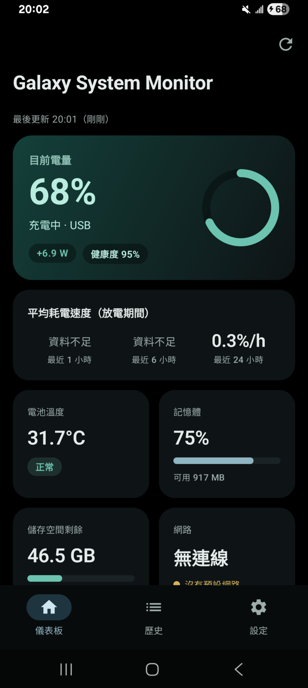
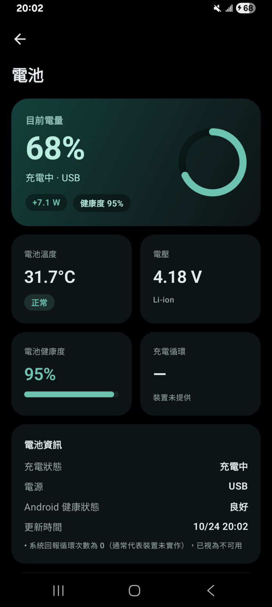
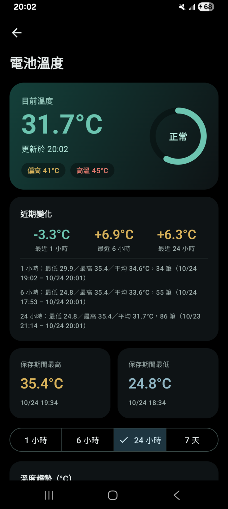
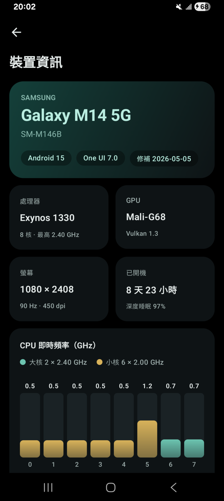
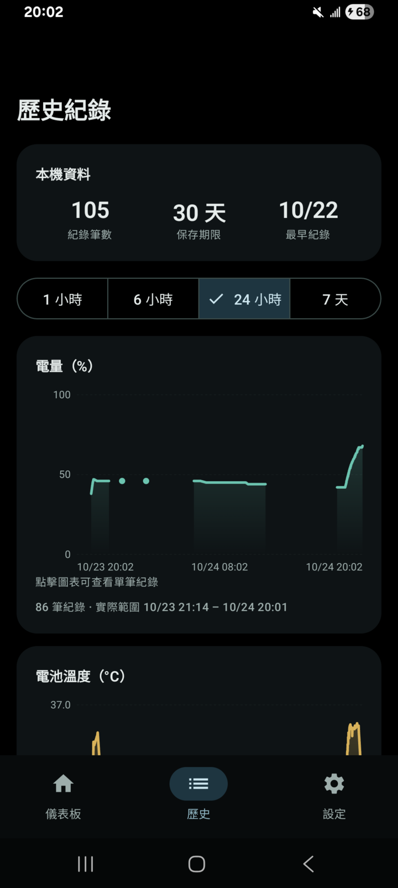
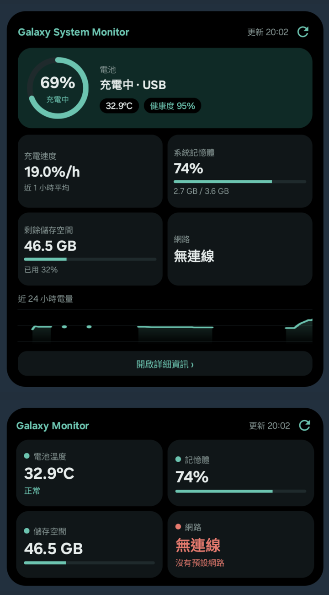

# Galaxy System Monitor

**繁體中文** | [English](README.en.md)

一款以 Kotlin 開發的原生 Android 手機狀態監控 App，附桌面 Widget。只透過 Android 公開 API 讀取真實的電池、記憶體、儲存空間、網路與裝置資訊，並將歷史紀錄保存在手機本機。不需要 Root、帳號，也沒有網際網路權限。

> 本專案以 Samsung Galaxy S25 Ultra（Android 16）為主要目標裝置設計，並已在 Galaxy S25 Ultra（Android 16）與 Galaxy M14 5G（Android 15）實機上測試主要功能，詳見[限制](#目前限制與尚未實作的功能)。本專案與 Samsung 無任何關聯。

## 目錄

- [主要功能](#主要功能)
- [畫面截圖](#畫面截圖)
- [技術與依賴](#技術與依賴)
- [系統需求](#系統需求)
- [安裝方式](#安裝方式)
- [從原始碼建置](#從原始碼建置)
- [使用說明](#使用說明)
- [隱私與權限](#隱私與權限)
- [專案結構](#專案結構)
- [測試](#測試)
- [目前限制與尚未實作的功能](#目前限制與尚未實作的功能)
- [開發者與授權](#開發者與授權)
- [問題回報](#問題回報)

## 主要功能

### 監控項目

| 項目 | 內容 |
|---|---|
| 電池 | 電量、充電狀態、電源類型、電池溫度、電壓、Android 健康狀態、電池技術、充電循環次數（Android 14 以上且裝置有提供時）、電池健康度（需 ADB 授權） |
| 即時功率 | 開著電池畫面時每 2 秒讀取電流、電壓、淨功率（W）、電量計剩餘 mAh，並畫出最近 10 分鐘曲線（不寫入資料庫） |
| 裝置資訊 | 型號與商品名稱、Android／One UI 版本、安全性修補程式、核心版本、處理器型號與各叢集最高頻率、每核心即時頻率（裝置允許時）、GPU／OpenGL ES／Vulkan、螢幕解析度與更新率、HDR、系統散熱狀態、開機時間與深度睡眠比例 |
| App 使用情況 | 各 App 今天／24 小時／7 天的前景使用時間，以及 Wi-Fi／行動數據／背景流量（需「使用情況存取權」） |
| 耗電／充電速度 | 最近 1、6、24 小時的平均放電速度，以及最近 1、6 小時的平均充電速度（單位：百分點／小時） |
| 電池溫度 | 目前溫度、最近 1／6／24 小時的變化（最低、最高、平均），以及保存期間內的最高／最低紀錄 |
| 系統記憶體 | 整機總量、可用量、使用中估算值、使用比例、系統低記憶體門檻與狀態 |
| 儲存空間 | 內部儲存總容量、已使用（含系統）、剩餘、使用比例 |
| 網路 | 是否連線、連線類型（Wi-Fi、行動網路、乙太網路、藍牙、VPN）、是否經由 VPN、網際網路能力、系統驗證結果、是否計量制、行動網路世代（選用）、最後一次狀態變化時間與近期變化紀錄 |

### 資料正確性原則

- 無法取得的數值會顯示「不可用」、「資料不足」或「權限不足」，**不會以 0 或推測值代替**。
- 系統回報的異常數值會被拒絕並說明原因，例如溫度回報 0、超出 −30～90 °C，或電壓異常。
- 耗電速度只使用相鄰且都在放電（或都在充電）的實際紀錄。間隔超過 3 小時、未接電源時電量上升，以及短時間異常跳動的區段都會排除，並顯示實際使用的資料時間範圍。
- 圖表遇到資料缺口時會斷線，不會插值補點。

### 歷史紀錄與圖表

- 使用 Room 保存在本機，預設保留 30 天（可選 7、14、30、60、90 天），過期資料自動清理。
- 圖表可切換 1 小時、6 小時、24 小時、7 天，點擊圖表可查看單筆紀錄，並標示實際可用的資料範圍。
- 歷史頁顯示電量、溫度、記憶體圖表與最近 100 筆紀錄。
- 可在設定中清除本 App 的所有歷史紀錄（只影響本 App 的資料庫）。

### 桌面 Widget

| Widget | 目標尺寸 | 顯示內容 |
|---|---|---|
| 系統監控（小） | 4 × 2 | 電池溫度、記憶體、剩餘儲存空間、網路四格；以顏色標示狀態，記憶體與儲存空間附使用率條，高度不足時改為單列 |
| 系統監控（大） | 4 × 4 | 電量圓環、充電狀態、溫度與健康度標籤、耗電（或充電）速度、記憶體與儲存空間（附使用率條）、網路、近 24 小時電量趨勢圖、「開啟詳細資訊」按鈕 |

- 右上角重新整理按鈕可手動更新。
- 點擊各區塊會開啟 App 中對應的詳細頁面。
- 外觀可選「AMOLED 純黑」、「深灰」或「跟隨系統深淺色」。
- 實際格數由啟動器與螢幕決定。

### 背景更新

- 使用 WorkManager 週期取樣，間隔可選 15、30、60 分鐘，也可關閉。實際執行時間由 Android 系統決定。
- App 畫面開啟時才會監聽即時電池廣播，並每 30 秒刷新畫面；離開畫面後即停止。
- 不使用前景服務，也不持續喚醒手機。

### 設定

深色模式（跟隨系統／深色／淺色）、AMOLED 純黑背景、Widget 外觀與趨勢圖、從 App 直接加入 Widget（啟動器支援時）、背景監控開關與取樣間隔、背景工作狀態、溫度提示門檻（預設偏高 40 °C、高溫警告 45 °C）、低儲存空間提醒門檻（預設 10%）、歷史保存期限、手動重新整理、清除歷史紀錄、權限狀態、關於。

## 畫面截圖

> 1.1.0 版，攝於 **Galaxy M14 5G 實機**（Android 15／One UI 7）充電中的狀態，數值皆為真實讀數，未經模擬。

| 儀表板 | 電池 | 電池溫度 |
|---|---|---|
|  |  |  |

| 裝置資訊 | 歷史紀錄 | 桌面 Widget |
|---|---|---|
|  |  |  |

電池頁的「充電循環」顯示「裝置未提供」，是因為 Samsung 將系統欄位回報為 0（見[限制](#目前限制與尚未實作的功能)）；網路顯示「無連線」是拍攝當下手機未連網。

## 技術與依賴

| 類別 | 內容 |
|---|---|
| 語言 | Kotlin 2.2.21 |
| UI | Jetpack Compose（BOM 2025.10.01）、Material 3 |
| Widget | Jetpack Glance 1.1.1 |
| 資料庫 | Room 2.8.3（KSP 2.2.21-2.0.4） |
| 背景工作 | WorkManager 2.10.5 |
| 設定儲存 | DataStore Preferences 1.1.7 |
| 導覽 | Navigation Compose 2.9.5 |
| 非同步 | Kotlin Coroutines 1.10.2、Flow |
| 建置 | Android Gradle Plugin 8.13.0、Gradle 8.14.3（Wrapper） |
| 架構 | MVVM + Repository、手動依賴注入（無 DI 框架） |
| 圖表 | 自製 Compose Canvas 圖表（無第三方圖表函式庫） |

所有依賴皆來自 AndroidX 與 Kotlin 官方函式庫，未使用廣告、分析或追蹤 SDK。

## 系統需求

| 項目 | 需求 |
|---|---|
| Android 版本 | Android 12（API 31）以上；targetSdk 為 36（Android 16） |
| Root | 不需要 |
| 帳號／網路 | 不需要 |
| 建置環境 | JDK 17 以上、Android SDK Platform 36 |

minSdk 設為 31，原因是 Widget 目標格數設定（`targetCellWidth`／`targetCellHeight`）與 `TelephonyCallback` 需要 Android 12 以上。

## 安裝方式

### 取得 APK

到 [GitHub Releases](https://github.com/q828626868-cell/GalaxySystemMonitor/releases) 下載最新版本的 APK（例如 `GalaxySystemMonitor-v1.1.0-debug.apk`）。各版本變更請見 [CHANGELOG.md](CHANGELOG.md)。也可以依照[從原始碼建置](#從原始碼建置)自行產生。

> 目前發布的是以 Android 預設偵錯金鑰簽署的 **Debug 版本**，尚未設定正式的 Release 簽署。每個 Release 頁面都附有 APK 的 SHA-256 雜湊值，可用來確認檔案完整性。

### 方法一：直接安裝到手機

1. 在手機上直接從 Releases 頁面下載 APK，或將 APK 複製到手機。
2. 在手機上開啟該檔案。若系統詢問，請允許此來源「安裝未知應用程式」。
3. 依畫面指示完成安裝。

### 方法二：使用 ADB 安裝（選用）

ADB 不是使用本 App 的必要條件，只是從電腦安裝時較方便。

1. 在手機上開啟「開發人員選項」與「USB 偵錯」。
2. 用 USB 連接電腦，並在手機上允許偵錯授權。
3. 執行：

```bash
adb devices                                              # 確認裝置已連線
adb install -r GalaxySystemMonitor-v1.1.0-debug.apk      # 從 Releases 下載的檔案
# 或自行建置的檔案：adb install -r app/build/outputs/apk/debug/app-debug.apk
```

## 從原始碼建置

```bash
git clone https://github.com/q828626868-cell/GalaxySystemMonitor.git
cd GalaxySystemMonitor
```

使用 Android Studio 開啟專案資料夾即可自動同步；或在指令列設定 Android SDK 路徑後建置：

```bash
# 建立 local.properties（此檔案不納入版本控制）
echo "sdk.dir=/path/to/Android/Sdk" > local.properties

./gradlew :app:assembleDebug        # Windows 請使用 gradlew.bat
```

產生的 APK 位於 `app/build/outputs/apk/debug/app-debug.apk`。

Release 版本目前尚未設定簽署金鑰。

## 使用說明

1. **開啟 App**：首頁會立即讀取一次資料並開始記錄。
2. **加入 Widget**：長按桌面空白處 → 小工具 → Galaxy System Monitor；或在 App 的「設定 > 外觀」按「加入小型／大型 Widget」。
3. **讓背景取樣穩定執行（Samsung 裝置建議）**：系統設定 > 應用程式 > Galaxy System Monitor > 電池 > 設為「不受限制」，並確認本 App 不在休眠或深度休眠應用程式清單中。App 的設定頁有按鈕可直接開啟此頁面。
4. **耗電速度需要累積資料**：最近 1 小時需至少 30 分鐘的有效放電紀錄，6 小時需 1.5 小時，24 小時需 4 小時；不足時會顯示「資料不足」。
5. **行動網路世代（選用）**：在網路頁按「顯示行動網路類型」並授予電話權限。不授權也不影響其他功能。
6. **App 使用情況（選用）**：在儀表板開啟「App 使用情況」，依畫面指示到系統設定開啟「使用情況存取權」；也可以用電腦執行 `adb shell appops set com.galaxy.systemmonitor GET_USAGE_STATS allow`。
7. **電池健康度（選用）**：此權限無法在 App 內申請，需用電腦執行 `adb shell pm grant com.galaxy.systemmonitor android.permission.BATTERY_STATS`，再重新開啟 App。

以上選用權限都可以隨時收回：使用情況存取權可在系統設定關閉；`BATTERY_STATS` 可用 `adb shell pm revoke` 收回。解除安裝 App 時也會一併移除。用 ADB 授權**不是 Root**，不會影響 Knox 或保固；授權完成後可關閉 USB 偵錯，權限仍然有效。

## 隱私與權限

| 權限 | 必要性 | 用途 |
|---|---|---|
| `ACCESS_NETWORK_STATE` | 必要（一般權限，自動授予） | 讀取連線狀態與類型 |
| `READ_PHONE_STATE` | 選用（執行時才要求） | 只用於讀取行動數據網路類型（4G／5G） |
| `WAKE_LOCK`、`RECEIVE_BOOT_COMPLETED` | 由 WorkManager 加入 | 執行排程取樣、重新開機後恢復排程 |
| `BATTERY_STATS` | 選用（只能用 ADB 授予） | 只用於讀取電池健康度百分比 |
| `PACKAGE_USAGE_STATS` | 選用（系統設定「使用情況存取權」或 ADB 授予） | 「App 使用情況」頁面的各 App 使用時間與網路流量 |
| `QUERY_ALL_PACKAGES` | 安裝時自動授予 | 把統計資料中的套件名稱／UID 顯示為 App 名稱與圖示 |

- **沒有 `INTERNET` 權限**，App 無法傳送任何資料。
- 歷史紀錄只存在 App 私有資料庫；已停用雲端備份與裝置間傳輸。
- 不存取照片、檔案、通訊錄或其他 App 的內容，也沒有清理、加速或刪除檔案的功能。
- 授予「使用情況存取權」後，App 會讀取「各 App 的使用時間與流量統計」並只在手機上顯示，不會保存到資料庫。

詳細檢查紀錄請見 [SECURITY_REPORT.md](SECURITY_REPORT.md)（繁體中文）。

## 專案結構

```
app/src/main/java/com/galaxy/systemmonitor/
├── data/
│   ├── source/      系統資訊讀取（電池、即時電流、記憶體、儲存空間、網路、裝置資訊、App 使用情況）
│   ├── db/          Room 資料表、DAO、對應
│   ├── settings/    DataStore 設定
│   └── MonitorRepository.kt
├── domain/          耗電速度計算、溫度分析、圖表資料處理、使用時間計算、CPU 叢集解析
├── work/            WorkManager 取樣工作、網路變化監聽
├── widget/          Glance 小型／大型 Widget
└── ui/              Compose 畫面、元件、主題、導覽
```

## 測試

```bash
./gradlew :app:testDebugUnitTest            # JVM 單元測試
./gradlew :app:connectedDebugAndroidTest    # 需連接裝置或模擬器
```

> `connectedDebugAndroidTest` 執行完會解除安裝 App，手機上的歷史紀錄與已授予的權限會一併清除。若在日常使用的手機上測試，請改用 `adb install -t` 安裝測試 APK 後以 `adb shell am instrument` 執行。

| 類型 | 數量 | 內容 |
|---|---|---|
| 單元測試 | 49 | 電池數值與健康度解析、異常值拒絕、電流單位換算與功率、耗電速度演算法、App 使用時間計算、CPU 叢集與頻率解析、機型／晶片名稱對照、溫度分級、圖表斷點、設定驗證、格式化 |
| 儀器測試 | 7 | 實際讀取系統 API、Room 空值欄位、取樣／節流／清理／清除流程、Widget 頁面白名單 |

1.1.0 的 49 個單元測試全部通過；7 個儀器測試已在 Galaxy M14 5G 實機（Android 15）上全部通過。

## 目前限制與尚未實作的功能

- **實機測試範圍有限**：已在 Galaxy S25 Ultra（Android 16）與 Galaxy M14 5G（Android 15／One UI 7）確認電池、即時功率、健康度與 App 使用情況；裝置資訊頁、新版介面與 Widget 只在 Galaxy M14 5G 上確認過。背景取樣在 Samsung 電池管理下的長期行為仍需觀察。
- **充電循環次數在 Samsung 裝置上通常不可用**：實測兩台 Galaxy 都將 Android 標準欄位 `EXTRA_CYCLE_COUNT` 回報為 0，App 會顯示「裝置未提供」而不是 0。Samsung 內部紀錄的用量只能透過電腦執行 `adb shell dumpsys battery` 查看，一般 App 受系統安全規則限制無法讀取。
- **電池健康度（最大容量 %）需要用 ADB 授權**：Android 14 的 `BATTERY_PROPERTY_STATE_OF_HEALTH` 需要 `BATTERY_STATS` 權限，執行 `adb shell pm grant com.galaxy.systemmonitor android.permission.BATTERY_STATS` 後才會顯示；部分裝置的電池驅動未提供此數值，App 不會推測。此數值由 Samsung 驅動提供（對應 `dumpsys battery` 的 `mSavedBatteryBsoh`），可能與 Samsung 其他內部數值不同。
- **即時功率是電池端的淨功率**（電池電壓 × 電流），不是充電頭輸出功率；充電保護在 80% 附近開關充電時，瞬間讀數可能劇烈跳動。
- **CPU 即時頻率視裝置而定**：部分裝置的安全規則不允許一般 App 讀取，此時只顯示各叢集的最高頻率。Android 8 起一般 App 也無法讀取 CPU 使用率。
- **商品名稱與晶片名稱**來自 App 內建的對照表，不在表中的機型只顯示原始代碼。
- 耗電速度是電量百分比的變化，受整數百分比解析度限制，不是電功率。
- 背景取樣時間由系統決定，可能因休眠、省電模式或 Samsung 電池管理而延後或停止。
- App 未執行時發生的網路變化，只能在下次取樣時才偵測到。
- Android 16 以上可能延後傳送「只有溫度變化」的電池廣播，因此溫度更新可能略有延遲。
- 介面目前只有繁體中文。
- 發布的 APK 為 Debug 版本（偵錯金鑰簽署、未經程式碼縮減），不適合上架商店。
- 尚未實作：正式 Release 簽署、網路延遲測試、通知提醒、資料匯出、電池健康度長期趨勢。

## 開發者與授權

- **開發者**：[q828626868-cell](https://github.com/q828626868-cell)
- **授權**：**尚未指定授權條款（License）**。在指定之前，本專案的著作權由作者保留，不代表採用任何開源授權。

## 問題回報

請到 [GitHub Issues](https://github.com/q828626868-cell/GalaxySystemMonitor/issues) 回報問題，並盡量提供：

- 手機型號、Android 版本與 One UI 版本
- App 版本（設定 > 關於本應用程式）
- 重現步驟、預期結果與實際結果
- 相關截圖（請先遮蔽個人資訊）
